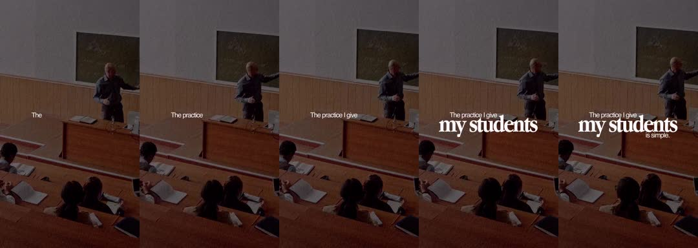

# v10_s38 · 02 B-roll + texto + overlay · 68.2–70.1s (calidad 4)

- **Guion:** The practice I give my students is simple.
- **Qué se ve:** Aula universitaria en anfiteatro, profesor ante pizarra verde, estudiantes de espaldas. 'The practice I give' pequeño, 'my students' grande, 'is simple.' pequeño.
- **Diseño:** 'my students' serif condensada blanca grande, resto sans pequeña. Centro de pantalla. Madera cálida, desaturado.
- **Efectos:** Grano, gradación neutra-cálida.
- **Animación:** Write-on por palabra; cámara fija.
- **Por qué aquí:** Autoridad del narrador como profesor; anuncia la práctica concreta (el 'cómo').
