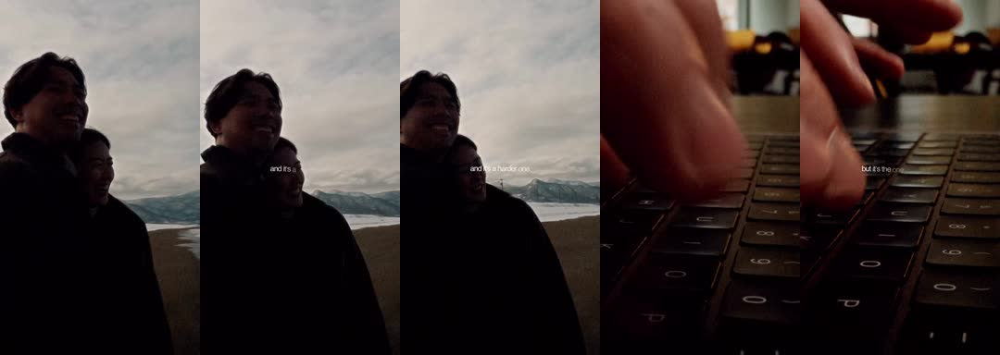

# v10_s43 · 02 B-roll + texto + overlay · 78.2–80.2s (calidad 3)

- **Guion:** and it's a harder one,
- **Qué se ve:** Pareja riendo abrazada en exterior nublado con montañas; luego manos tecleando en un portátil (cálido). 'and it's a harder one,' pequeño.
- **Diseño:** Sans pequeña blanca centrada a media altura (el texto se ubica sobre el cuerpo en la primera toma y más arriba en la segunda).
- **Efectos:** Grano, tonos fríos/cálidos alternados.
- **Animación:** Write-on por palabra ('harder one,' en gris primero); corte de b-roll a mitad de frase.
- **Por qué aquí:** Texto de tránsito; b-roll de vida cotidiana (relaciones, trabajo) = donde se hace el 'proyecto'.
