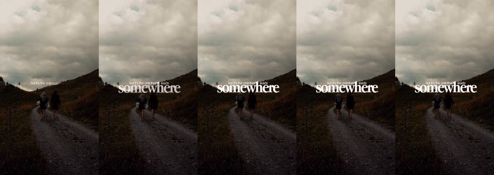

# v10_s44 · 02 B-roll + texto + overlay · 80.2–81.7s (calidad 4)

- **Guion:** but it's the one that leads somewhere.
- **Qué se ve:** Dos personas caminando por un camino de tierra en colinas bajo cielo nublado. 'but it's the one that leads' pequeño y 'somewhere' grande.
- **Diseño:** 'somewhere' serif condensada blanca grande, prefijo sans pequeña con 'leads' como super-índice derecha. Tercio medio.
- **Efectos:** Gradación desaturada terrosa, grano.
- **Animación:** Write-on; 'somewhere' entra gris y se ilumina.
- **Por qué aquí:** Literaliza 'lleva a algún sitio' con un camino; esperanza.
