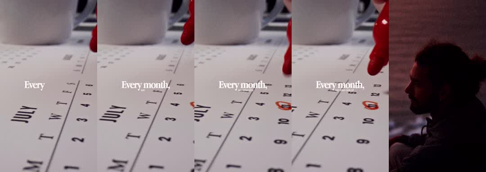

# v10_s47 · 02 B-roll + texto + overlay · 86.4–87.7s (calidad 4)

- **Guion:** Every month, we take one of
- **Qué se ve:** Primer plano de un calendario de papel (JULY) en ángulo con una mano con rotulador rojo marcando una fecha. 'Every month,' grande, 'we take one of' pequeño.
- **Diseño:** 'Every month,' serif condensada blanca; 'we take one of' sans diminuta debajo. Tercio medio-superior.
- **Efectos:** Poca profundidad de campo, colores claros con rojo.
- **Animación:** Write-on; el rotulador se mueve (acción real).
- **Por qué aquí:** Concreta la cadencia mensual de la membresía con un objeto literal.
