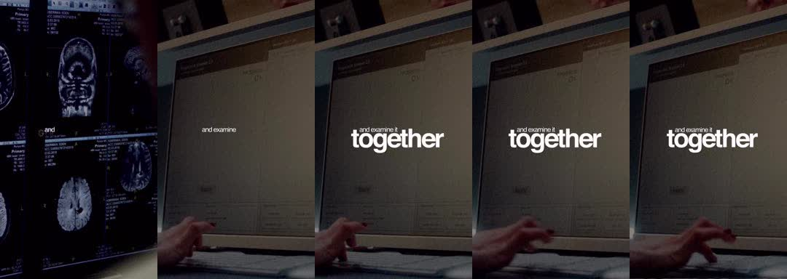

# v10_s49 · 02 B-roll + texto + overlay · 89.3–90.6s (calidad 4)

- **Guion:** and examine it together,
- **Qué se ve:** Breve plano de monitores con resonancias cerebrales ('and examine'), luego pantalla de ordenador con mano tecleando: 'and examine it' pequeño y 'together' grande.
- **Diseño:** 'together' sans grotesca bold blanca grande, 'and examine it' sans pequeña. Centro.
- **Efectos:** Pantallas con brillo frío, grano.
- **Animación:** Corte rápido entre dos b-rolls con texto persistente; pop en 'together'.
- **Por qué aquí:** 'Examinar' = ciencia/estudio; 'juntos' en bold para remarcar comunidad.
