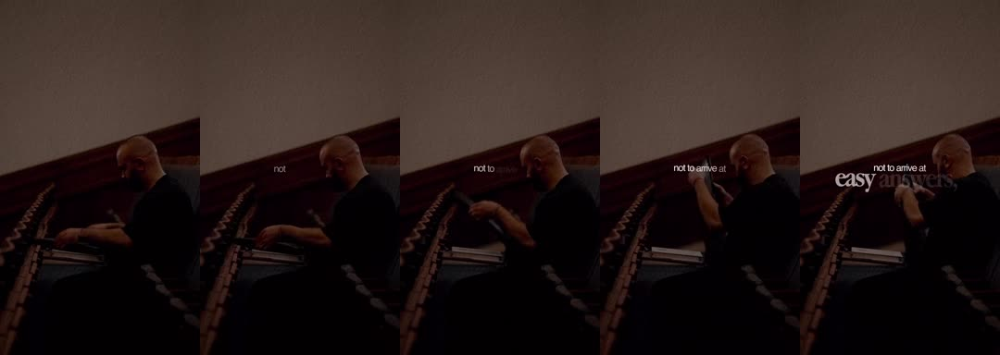

# v10_s51 · 02 B-roll + texto + overlay · 94.6–95.8s (calidad 4)

- **Guion:** Not to arrive at easy answers,
- **Qué se ve:** Hombre calvo sentado en butacas de auditorio en diagonal mirando una tablet, oscuro. 'not to arrive at' pequeño y 'easy' grande en gris semitransparente.
- **Diseño:** 'easy' serif condensada gris (opacidad ~50%) — deliberadamente apagada; prefijo sans pequeña blanca. Tercio superior-izquierda.
- **Efectos:** Low-key, grano, composición diagonal.
- **Animación:** Write-on; 'easy' nunca llega a blanco (se queda gris).
- **Por qué aquí:** La palabra 'fácil' se desvaloriza visualmente (gris) porque el guion la niega.
