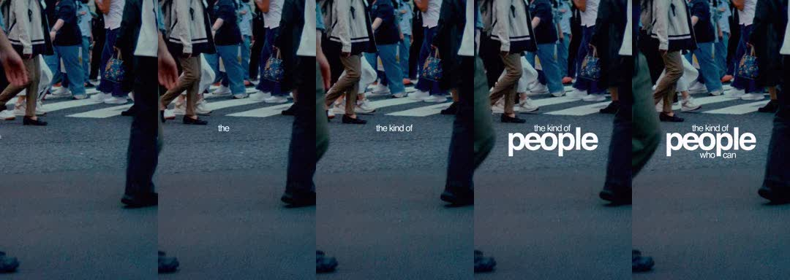

# v10_s53 · 02 B-roll + texto + overlay · 97.2–98.3s (calidad 4)

- **Guion:** the kind of people who can
- **Qué se ve:** Piernas de multitud cruzando un paso de cebra. 'the kind of' pequeño, 'people' enorme, 'who' pequeño.
- **Diseño:** 'people' sans grotesca bold blanca grande; 'the kind of' y 'who' sans pequeñas. Tercio superior-medio.
- **Efectos:** Gradación fría, grano.
- **Animación:** Write-on, pop en 'people'.
- **Por qué aquí:** 'Gente' = multitud anónima; el espectador se ve como uno más.
