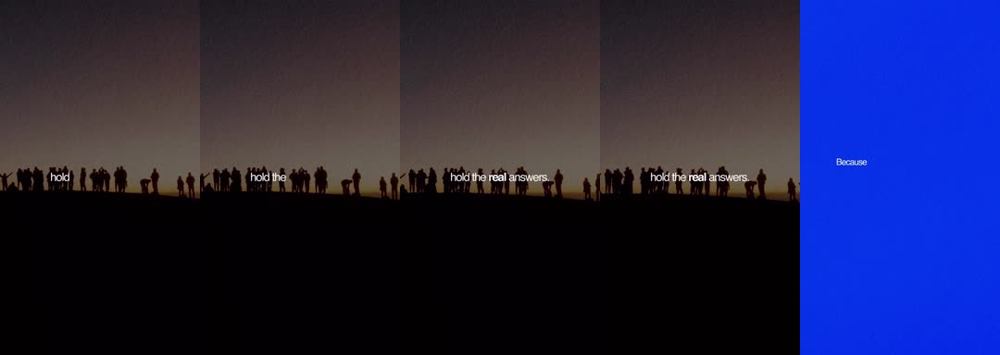

# v10_s54 · 02 B-roll + texto + overlay · 98.3–100.3s (calidad 4)

- **Guion:** hold the real answers.
- **Qué se ve:** Siluetas de un grupo de personas sobre el horizonte al anochecer (cielo naranja/gris). 'hold' y luego 'hold the real answers.' con 'real' en negrita.
- **Diseño:** Sans blanca mediana con 'real' bold; línea centrada sobre el horizonte. Mitad de pantalla.
- **Efectos:** Contraluz crepuscular, grano.
- **Animación:** Write-on por palabra.
- **Por qué aquí:** Comunidad (grupo) que 'sostiene' las respuestas; énfasis tipográfico mínimo en 'real'.
