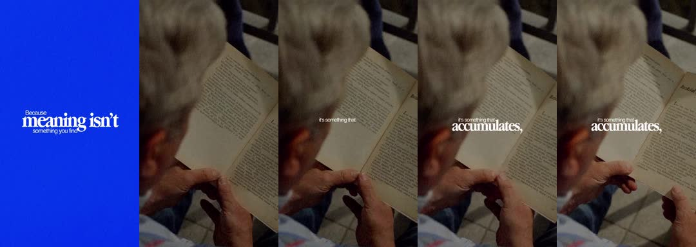

# v10_s56 · 02 B-roll + texto + overlay · 101.6–104.0s (calidad 4)

- **Guion:** you find once, it's something that accumulates,
- **Qué se ve:** Primer plano de un anciano leyendo un libro viejo (manos, páginas amarillentas). 'it's something that' pequeño y 'accumulates,' grande.
- **Diseño:** 'accumulates,' serif condensada blanca, prefijo sans pequeña. Centro.
- **Efectos:** Cálido, grano, poca profundidad de campo.
- **Animación:** Write-on.
- **Por qué aquí:** Acumular = edad y lectura: sabiduría que se gana con años.
