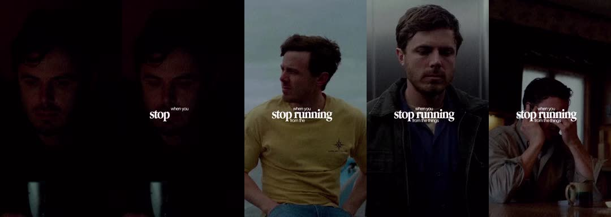

# v10_s58 · 02 B-roll + texto + overlay · 105.6–107.7s (calidad 5)

- **Guion:** when you stop running from the things
- **Qué se ve:** Montaje rápido de un mismo actor (plano oscuro, en camiseta amarilla junto al mar, con chaqueta, conduciendo bajo la lluvia, con la cabeza entre las manos en una mesa) con el texto fijo 'when you / stop running / from the things'.
- **Diseño:** 'stop running' serif condensada blanca grande, 'when you' sans pequeña encima, 'from the things' sans pequeña debajo a la derecha. Centrado en la mitad superior, posición fija durante todo el montaje.
- **Efectos:** Gradaciones cinematográficas frías (azul-gris), grano.
- **Animación:** Texto fijo mientras el b-roll corta cada ~0.4–0.5 s (montaje acelerado); write-on de 'stop' → 'running' → 'from' → 'the things'.
- **Por qué aquí:** Clímax emocional: el montaje rápido de un personaje en duelo (huida, conducción, derrumbe) contra el texto quieto = dejar de correr.
