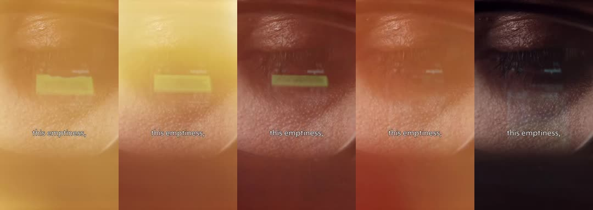

# v11_s02 · 02 B-roll + texto + overlay · 0.8–1.3s (calidad 4)

- **Guion:** this emptiness,
- **Qué se ve:** Destello de light leak dorado/blanco (0.75–0.92) que da paso a un macro extremo de un ojo humano con piel en tonos naranja-cobre; caption 'this emptiness,' encima.
- **Diseño:** Mismo caption sans fina blanco centrado a ~63 %. Paleta del flash: #E9CE8D, #FBFAF6, #C99135; macro del ojo #9A5027–#CA8E69.
- **Efectos:** Light leak / film burn dorado a pantalla casi completa, sobreexposición, grano fino; macro con mucho desenfoque y tono ámbar.
- **Animación:** Flash de luz de 0.15–0.2 s como transición (sube a blanco cálido y se disuelve), luego micro-plano de 0.4 s. Sensación de 'parpadeo' emocional, seca y rápida.
- **Por qué aquí:** La palabra abstracta 'vacío' se convierte en imagen íntima (un ojo): describe la emoción sin explicarla. El light leak marca el tono cálido-espiritual del documental desde el segundo 1.
