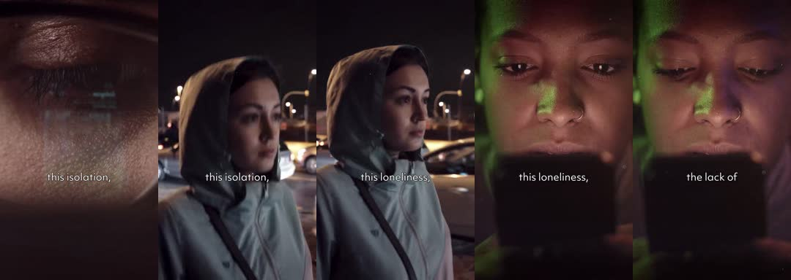

# v11_s03 · 02 B-roll + texto + overlay · 1.3–3.2s (calidad 4)

- **Guion:** this isolation, this loneliness,
- **Qué se ve:** Mujer joven con capucha caminando sola de noche en la calle, farolas y luces de coches desenfocadas detrás; mirada perdida a la izquierda.
- **Diseño:** Caption sans fina blanca centrada (~63 %), una palabra-clave por golpe: 'this isolation,' / 'this loneliness,'. Paleta nocturna #120E13, #2F292D, #4B4D55.
- **Efectos:** Bokeh urbano, grade frío-cálido (piel cálida, entorno gris azulado), grano cinematográfico.
- **Animación:** Corte seco; leve movimiento de cámara en mano siguiendo a la mujer. Captions cambian al ritmo de cada palabra enumerada (~0.8 s cada una).
- **Por qué aquí:** Enumeración de tres males (vacío, aislamiento, soledad): cada concepto recibe su imagen-metáfora de stock. 'Soledad' = persona sola en ciudad de noche, lectura instantánea.
