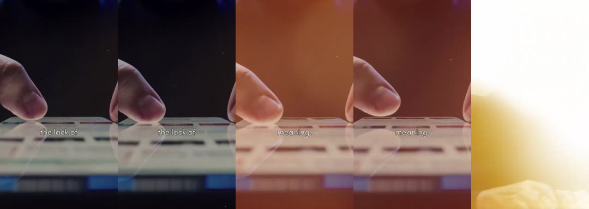

# v11_s04 · 02 B-roll + texto + overlay · 3.2–3.9s (calidad 3)

- **Guion:** the lack of meaning.
- **Qué se ve:** Macro de un dedo tocando una pantalla/teclado táctil iluminado, en tonos burdeos-violeta; termina con un flash blanco-dorado (3.79–3.88).
- **Diseño:** Caption 'meaning.' sans fina blanca centrada a ~63 %. Paleta #9A5027/#AD6438 con reflejos azul-violeta de la pantalla.
- **Efectos:** Macro con profundidad mínima, glow de la pantalla, light leak de cierre a blanco cálido.
- **Animación:** Plano de 0.6 s; el dedo baja hacia la pantalla (acción mínima); flash de 0.1–0.2 s para salir.
- **Por qué aquí:** 'Falta de sentido' asociada a la tecnología/pantalla: insinúa la causa sin decirla. El flash cierra la enumeración del hook y marca el cambio de hablante.
