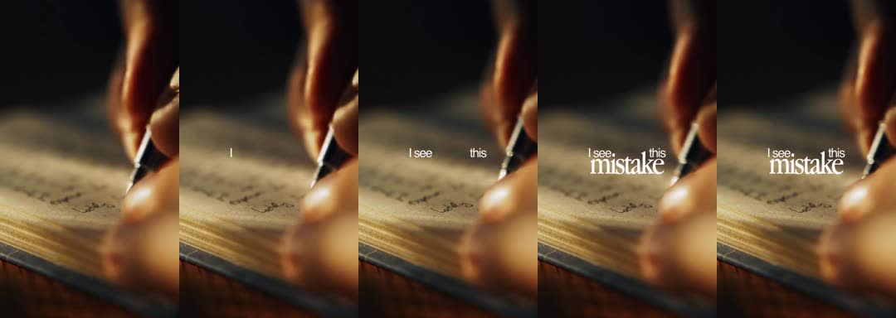

# v12_s03 · 02 B-roll + texto + overlay · 3.7–4.6s (calidad 3)

- **Guion:** I see this mistake all
- **Qué se ve:** Macro cálido de una mano escribiendo con estilográfica en un libro de cuentas antiguo.
- **Diseño:** Caption sans regular blanca pequeña, palabras separadas en horizontal ('I see' … 'this') a ~47 % de altura.
- **Efectos:** Profundidad de campo mínima, grade ámbar #8D744C sobre negros #0D0B0C, grano.
- **Animación:** Corte seco; leve movimiento de la mano; palabras aparecen con la voz.
- **Por qué aquí:** Transición del concepto a 'la gente que veo': b-roll de trabajo/esfuerzo para introducir a quienes 'han trabajado mucho'.
