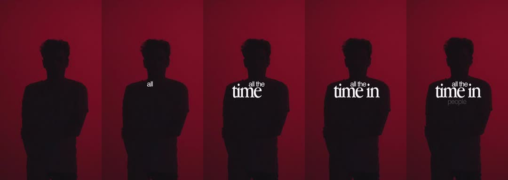

# v12_s04 · 02 B-roll + texto + overlay · 4.6–5.6s (calidad 4)

- **Guion:** the time in
- **Qué se ve:** Silueta negra de un hombre de pie contra fondo rojo carmesí plano.
- **Diseño:** 'all the' sans pequeña blanca + 'time' serif condensada grande blanca, apilados y solapados, centrados a ~50 %. Fondo #781720/#69151D, silueta #150F13.
- **Efectos:** Contraluz duro, viñeta, grano.
- **Animación:** Corte seco; texto karaoke (palabra pequeña primero, luego la grande con fade+leve escala).
- **Por qué aquí:** Color rojo inesperado = alarma/urgencia ('todo el tiempo'). La silueta anónima permite que cualquiera se proyecte.
