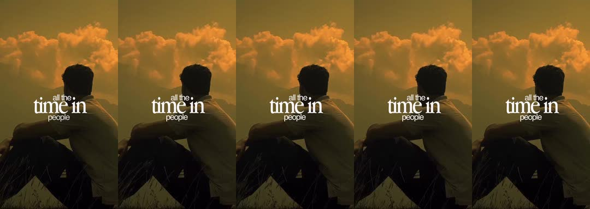

# v12_s05 · 02 B-roll + texto + overlay · 5.6–6.4s (calidad 3)

- **Guion:** people who
- **Qué se ve:** Silueta de hombre sentado en rocas frente a un cielo dorado de atardecer con nubes.
- **Diseño:** 'all the / time in / people' — serif condensada grande blanca 'time in' con sans pequeña arriba y abajo, centrado ~50 %. Paleta #8D6827/#6F5723.
- **Efectos:** Contraluz dorado, grano.
- **Animación:** Corte seco; continúa el karaoke del bloque anterior.
- **Por qué aquí:** Mantiene la frase viva sobre una imagen contemplativa (persona sola mirando el horizonte = búsqueda).
