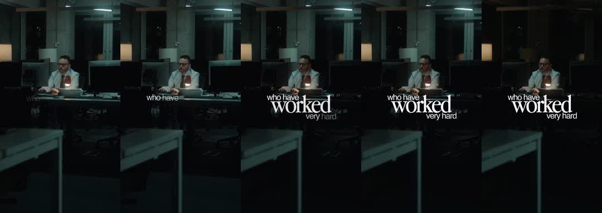

# v12_s06 · 02 B-roll + texto + overlay · 6.4–7.4s (calidad 3)

- **Guion:** have worked very hard
- **Qué se ve:** Hombre solo trabajando en una oficina oscura de noche, iluminado por la lámpara/monitor.
- **Diseño:** 'who have' sans pequeña + 'worked' serif condensada grande + 'very hard' sans pequeña (hard en fantasma), centrado a ~47 %, blanco. Paleta #050809/#263433.
- **Efectos:** Ambiente frío-verdoso oscuro, grano.
- **Animación:** Corte seco; karaoke por palabra con ghost-text.
- **Por qué aquí:** Literaliza 'trabajar muy duro' (horas extra, soledad).
