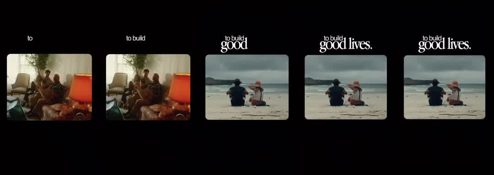

# v12_s07 · 02 B-roll + texto + overlay · 7.4–8.4s (calidad 4)

- **Guion:** to build good lives.
- **Qué se ve:** Fondo negro con una tarjeta de vídeo de esquinas redondeadas en el centro: primero una familia leyendo en un salón con lámpara naranja, luego una pareja sentada en la playa de espaldas. Encima: 'to build / good lives.'
- **Diseño:** Tarjeta de vídeo ~85 % del ancho, ratio ~4:3, radio de esquina ~4 %, centrada a ~55 %. Texto: 'to build' sans pequeña blanca + 'good lives.' serif condensada grande blanca, sobre la tarjeta a ~25 % de altura. Fondo #000001.
- **Efectos:** Sin sombra; vídeo con look cinematográfico cálido/frío.
- **Animación:** Texto karaoke por palabra; el vídeo dentro de la tarjeta cambia de plano por corte seco a mitad.
- **Por qué aquí:** 'Buenas vidas' = recuerdos (familia, pareja): el marco redondeado los presenta como 'fotos/recuerdos' del espectador.
