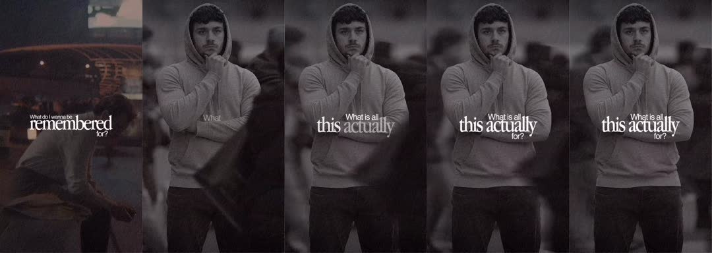

# v12_s16 · 02 B-roll + texto + overlay · 25.5–26.9s (calidad 3)

- **Guion:** What is all this actually for?
- **Qué se ve:** Joven con sudadera gris y capucha, mano en la barbilla, pensativo, de frente; desaturado.
- **Diseño:** 'What is all' sans pequeña + 'this actually' serif condensada grande, blanco/gris (ghost en 'actually'), centrado ~52 %.
- **Efectos:** Desaturación casi total, grano, viñeta.
- **Animación:** Corte; ghost-text ilumina palabra a palabra.
- **Por qué aquí:** Retrato de 'pensar' = cara para la pregunta más directa.
