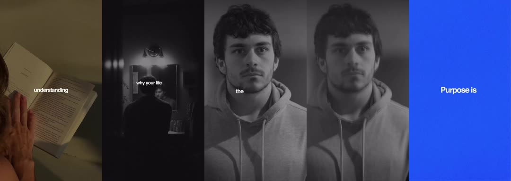

# v12_s22 · 02 B-roll + texto + overlay · 37.3–40.8s (calidad 3)

- **Guion:** why your life is unfolding the way that it is.
- **Qué se ve:** Tres planos rápidos: mano sobre un libro abierto (lectura cálida), hombre en penumbra bajo una lámpara colgante, retrato desaturado de joven mirando a cámara.
- **Diseño:** Caption sans regular blanca pequeña centrada ~40–50 %: 'understanding', 'why your life', 'the way that it is.'.
- **Efectos:** Desaturación progresiva (cálido → b/n), grano, viñeta.
- **Animación:** Cortes secos cada ~0.5–2 s; captions por frase.
- **Por qué aquí:** Definición de coherencia = entenderse a uno mismo: imágenes de introspección y mirada directa.
