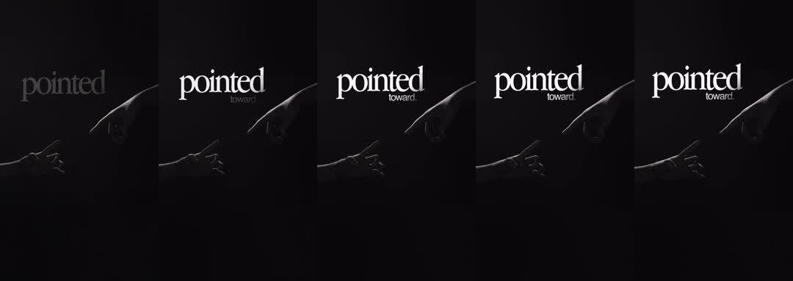

# v12_s24 · 02 B-roll + texto + overlay · 41.9–43.3s (calidad 5)

- **Guion:** is pointed toward,
- **Qué se ve:** Dos manos en claroscuro sobre negro, un dedo apuntando hacia otro (homenaje a La creación de Adán).
- **Diseño:** 'pointed' serif condensada blanca grande + 'toward.' sans pequeña, arriba-izquierda a ~25–30 % de altura. Fondo #0B080C.
- **Efectos:** Luz rasante, alto contraste, grano.
- **Animación:** Corte; 'pointed' entra en ghost y se ilumina; manos se acercan lentamente.
- **Por qué aquí:** Literaliza 'apuntado hacia' con un gesto icónico: juego visual palabra-imagen.
