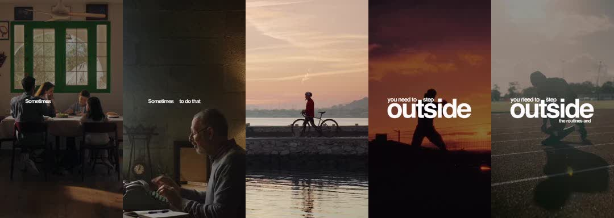

# v12_s31 · 02 B-roll + texto + overlay · 53.8–57.9s (calidad 4)

- **Guion:** Sometimes, to do that work well, you need to step outside the routines and demands
- **Qué se ve:** Secuencia: hombre mayor escribiendo a máquina; familia cenando en un comedor con ventana verde; ciclista con bici frente a un lago al atardecer; corredor en una pista al amanecer.
- **Diseño:** Captions sans pequeña blanca ('Sometimes', 'to do that', 'you need'); clímax 'you need to step / outside / the routines and' con 'outside' en sans grotesca heavy blanca muy grande (~4× caption), centrado ~50 %.
- **Efectos:** Grades cálidos de atardecer #D3B091/#6F3724, contraluz, grano.
- **Animación:** Cortes cada ~1 s; 'outside' pop con escala grande sincronizado.
- **Por qué aquí:** 'Salir afuera' se acompaña de exteriores abiertos y luz natural; la palabra clave en el peso más grueso del video.
