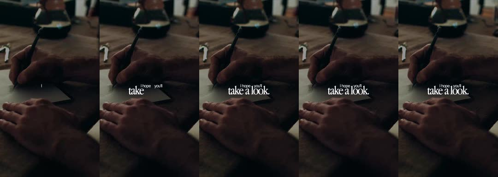

# v12_s43 · 02 B-roll + texto + overlay · 85.0–85.9s (calidad 3)

- **Guion:** hope you'll take a look.
- **Qué se ve:** Manos escribiendo con bolígrafo en una mesa de madera oscura.
- **Diseño:** 'I hope you'll' sans pequeña + 'take a look.' serif condensada blanca grande, centrado ~50 %.
- **Efectos:** Grade cálido oscuro.
- **Animación:** Corte; karaoke.
- **Por qué aquí:** Invitación personal (escribir = apuntarse) antes del CTA.
