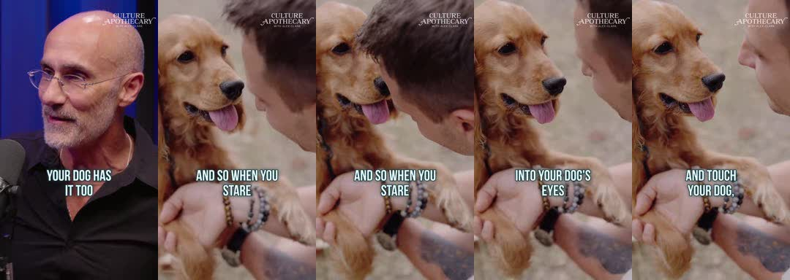

# v13_s11 · 02 B-roll + texto + overlay · 38.4–41.6s (calidad 3)

- **Guion:** And so when you stare into your dog's eyes and touch your dog,
- **Qué se ve:** Stock: cocker spaniel dorado mirando a cámara mientras un hombre lo acaricia y le sostiene la pata.
- **Diseño:** Caption condensada bold MAYÚSCULAS blanca ~65 %.
- **Efectos:** Stock cálido, poca profundidad de campo.
- **Animación:** Corte seco; sale con fundido cruzado (~0.4 s) hacia Brooks.
- **Por qué aquí:** Muestra literal de 'mirar a tu perro a los ojos': emoción y ternura.
