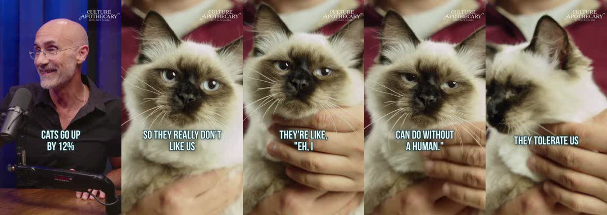

# v13_s14 · 02 B-roll + texto + overlay · 47.9–52.2s (calidad 4)

- **Guion:** Yeah, so they really don't like us. They're like, eh, I can do without a human. They tolerate us.
- **Qué se ve:** Stock: gato ragdoll/siamés con cara de desgana mientras una mano le rasca la barbilla; entorna los ojos.
- **Diseño:** Caption condensada bold MAYÚSCULAS blanca ~65 % ('SO THEY REALLY DON'T LIKE US', 'THEY TOLERATE US').
- **Efectos:** Fondo granate desenfocado.
- **Animación:** Corte seco; el gato cierra los ojos (timing cómico).
- **Por qué aquí:** Humor: la expresión del gato 'actúa' el chiste; el b-roll ilustra literalmente la broma.
