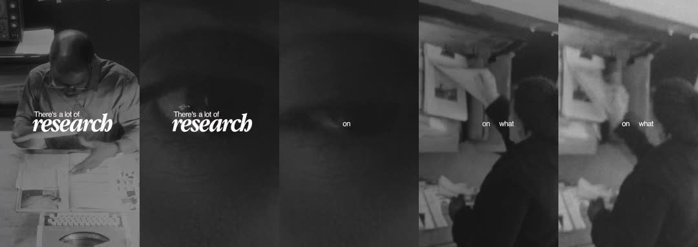

# v16_s03 · 02 B-roll + texto + overlay · 3.1–4.0s (calidad 4)

- **Guion:** of research on what makes
- **Qué se ve:** B-roll de archivo B/N: investigador leyendo papeles en un escritorio, luego persona colgando fotos en un tablero. 'There's a lot of' pequeño + 'research' serif itálica bold grande; después 'on'.
- **Diseño:** Palabra clave en serif itálica bold blanca (tipo Playfair Display Bold Italic) ~2.5x; relleno sans pequeña encima. Centro.
- **Efectos:** B/N, grano de archivo, desaturación total.
- **Animación:** Dos cortes muy cortos (0.25 y 0.6 s); palabra clave pop+blur-in.
- **Por qué aquí:** 'Research' → imagen de investigación: valida con autoridad visual en <1 s.
