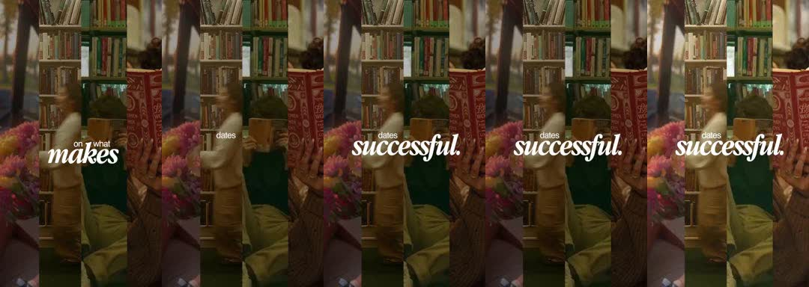

# v16_s04 · 02 B-roll + texto + overlay · 4.0–5.2s (calidad 4)

- **Guion:** dates successful.
- **Qué se ve:** B-roll cálido de librería/biblioteca con flores en primer término; 'dates' pequeño + 'successful.' serif itálica bold blanca grande al centro.
- **Diseño:** Serif itálica bold blanca ~70 % ancho; sans pequeña arriba. Centro exacto.
- **Efectos:** Grading cálido ámbar, ligera desaturación, profundidad de campo baja.
- **Animación:** Pop + blur-in de la palabra (~0.2 s); leve push-in de cámara.
- **Por qué aquí:** Concepto positivo ('éxito en citas') con estética romántica-intelectual (libros + flores).
