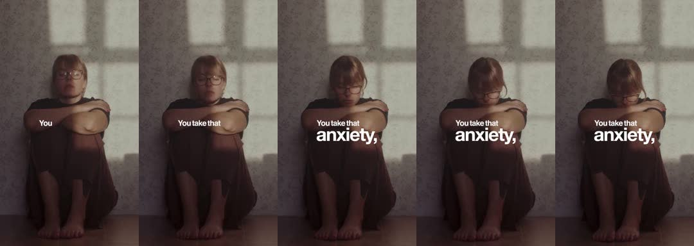

# v16_s13 · 02 B-roll + texto + overlay · 25.6–26.9s (calidad 4)

- **Guion:** You take that anxiety, you
- **Qué se ve:** Mujer sentada en el suelo abrazando las rodillas junto a una ventana; 'You take that' + 'anxiety,'.
- **Diseño:** Sans bold blanca, clave grande, centro.
- **Efectos:** Luz natural suave, desaturado cálido.
- **Animación:** Corte; pop por palabra.
- **Por qué aquí:** 'Anxiety' → imagen emocional de ansiedad (b-roll para emoción).
