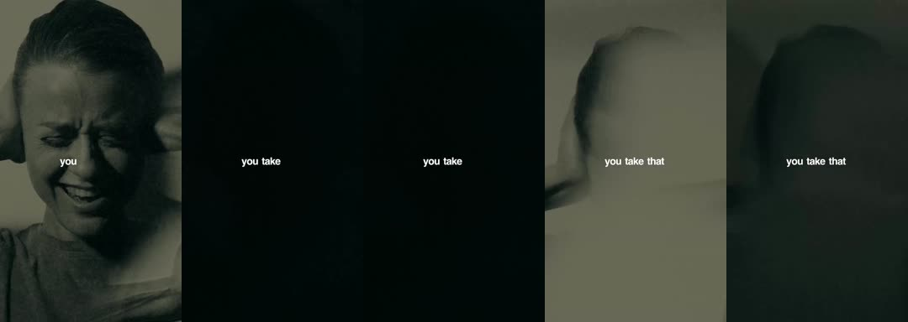

# v16_s14 · 02 B-roll + texto + overlay · 26.9–27.4s (calidad 3)

- **Guion:** take that sense
- **Qué se ve:** Plano casi negro (oscuridad) con 'you take that' + 'sense'.
- **Diseño:** Sans bold blanca centro sobre negro #000504.
- **Efectos:** Oscuridad casi total, grano.
- **Animación:** Corte seco de 0.5 s.
- **Por qué aquí:** Negro = vacío/miedo; respiración visual dentro de la secuencia emocional.
