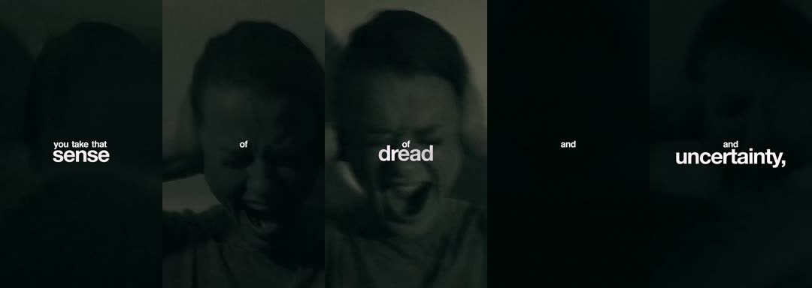

# v16_s15 · 02 B-roll + texto + overlay · 27.4–28.8s (calidad 4)

- **Guion:** of dread and uncertainty
- **Qué se ve:** Rostro granulado en penumbra verdosa (persona angustiada); 'of' + 'dread' y luego 'and' + 'uncertainty,' en gris.
- **Diseño:** Sans bold, 'uncertainty' en gris claro (no blanco) = baja certeza.
- **Efectos:** Grano fuerte, desaturación verde-gris, blur.
- **Animación:** Palabras pop; leve zoom.
- **Por qué aquí:** Emoción negativa con textura sucia; el gris en 'uncertainty' refuerza el significado.
