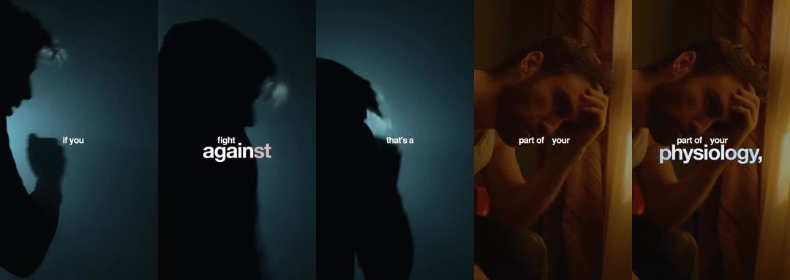

# v16_s21 · 02 B-roll + texto + overlay · 50.4–54.2s (calidad 4)

- **Guion:** If you try to fight against something that's a normal part of your physiology,
- **Qué se ve:** Silueta de cabeza en contraluz sobre fondo verde-azulado oscuro ('fight' + 'against' + 'something'); luego hombre con la mano en la cabeza en luz cálida ('part of your').
- **Diseño:** Sans bold blanca, clave grande, centro.
- **Efectos:** Contraluz, tonos teal #132931, grano.
- **Animación:** Corte; pop por palabra.
- **Por qué aquí:** 'Fight against' → imagen de lucha interna (emoción negativa).
