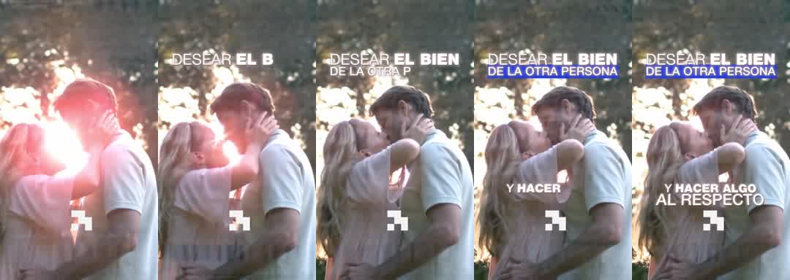

# v17_s04 · 02 B-roll + texto + overlay · 6.5–11.0s (calidad 4)

- **Guion:** es desear el bien de la otra persona y hacer algo al respecto.
- **Qué se ve:** B-roll de pareja besándose al sol con fuga de luz roja (light leak); 'DESEAR EL BIEN' arriba con 'EL BIEN' bold, 'DE LA OTRA PERSONA' sobre caja azul; luego 'Y HACER'.
- **Diseño:** Sans heavy MAYÚSCULAS blanca, tercio superior (~20 %); segunda línea en caja azul #1A2BE0. Logo abajo.
- **Efectos:** Light leak rojo/rosado sobreexpuesto en la entrada, contraluz cálido.
- **Animación:** Entrada con flash de luz; texto palabra a palabra; caja azul wipe.
- **Por qué aquí:** Definición de amor → imagen romántica literal (b-roll para emoción).
