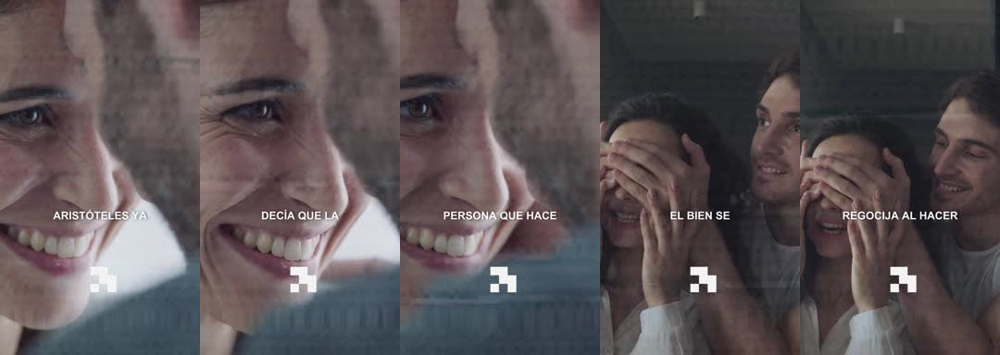

# v17_s05 · 02 B-roll + texto + overlay · 11.0–15.3s (calidad 3)

- **Guion:** Aristóteles ya decía que la persona que hace el bien se regocija al
- **Qué se ve:** B-roll de primerísimos planos de rostros sonriendo (mujer, hombre tapando ojos de mujer); captions pequeños 'ARISTÓTELES YA', 'PERSONA QUE HACE', 'EL BIEN SE'.
- **Diseño:** Sans bold MAYÚSCULAS blanca pequeña (~2.5 % altura), centro (~60 %).
- **Efectos:** Planos macro con desenfoque, tonos fríos.
- **Animación:** Cortes cada ~1.5 s; captions palabra a palabra.
- **Por qué aquí:** Mantiene emoción (alegría) mientras se cita autoridad; captions pequeños = relleno.
