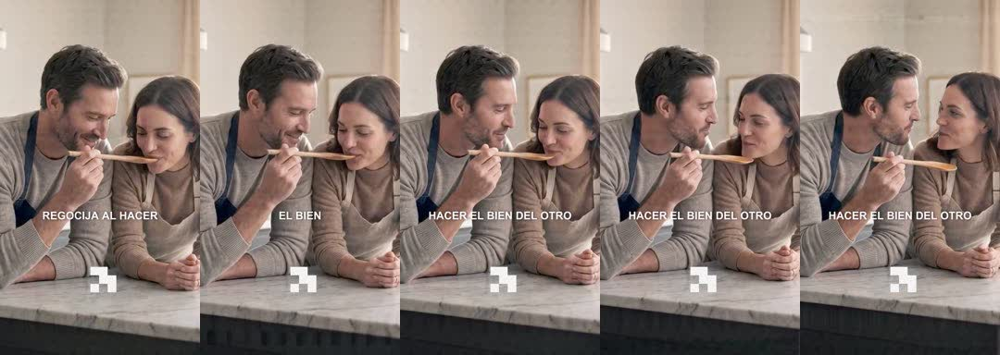

# v17_s06 · 02 B-roll + texto + overlay · 15.3–17.5s (calidad 3)

- **Guion:** hacer el bien. Hacer el bien del otro
- **Qué se ve:** Pareja en cocina, él le da a probar con cuchara de madera; 'EL BIEN', 'HACER EL BIEN DEL OTRO'.
- **Diseño:** Sans bold MAYÚSCULAS blanca pequeña centro.
- **Efectos:** Luz natural cálida de stock.
- **Animación:** Plano sostenido; captions.
- **Por qué aquí:** 'Hacer el bien' = gesto cotidiano de cuidado.
