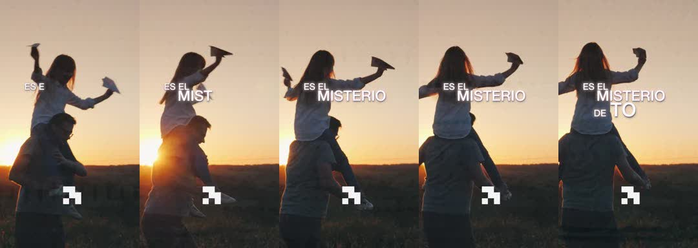

# v18_s04 · 02 B-roll + texto + overlay · 9.6–11.4s (calidad 4)

- **Guion:** Es el misterio de
- **Qué se ve:** Niña sobre los hombros de su padre lanzando un avión de papel al atardecer; 'ES EL' pequeño + 'MISTERIO' grande + 'DE'.
- **Diseño:** Sans heavy MAYÚSCULAS blanca; tercio superior (~35 %).
- **Efectos:** Contraluz dorado.
- **Animación:** Corte; pop.
- **Por qué aquí:** 'Misterio de la vida' con imagen de infancia/juego.
