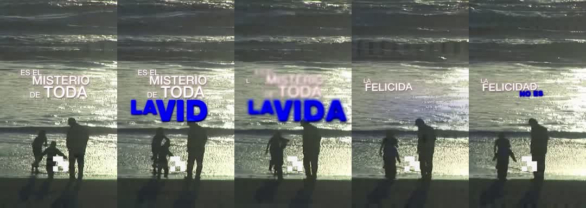

# v18_s05 · 02 B-roll + texto + overlay · 11.4–13.5s (calidad 4)

- **Guion:** toda la vida.
- **Qué se ve:** Siluetas en la orilla de noche, imagen granulada verdosa con un trazo de luz azul horizontal; 'MISTERIO DE TODA' fantasma + 'LA VIDA' azul gigante.
- **Diseño:** Sans heavy MAYÚSCULAS, 'LAVIDA' azul #1A2BE0 ancho completo con borde blanco; centro.
- **Efectos:** Grano fuerte, sobreexposición, rayo de luz azul (light streak) con blur.
- **Animación:** Texto anterior se desvanece en ghost mientras entra el nuevo; streak azul cruza la pantalla.
- **Por qué aquí:** Clímax de la frase; textura onírica = misterio.
