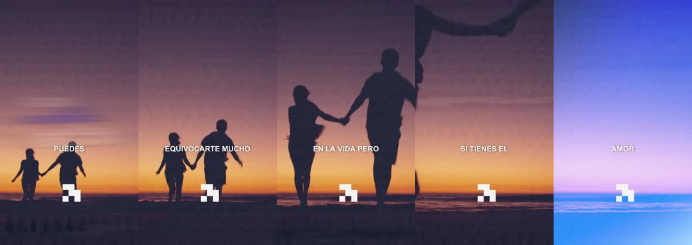

# v18_s07 · 02 B-roll + texto + overlay · 15.6–19.4s (calidad 4)

- **Guion:** dirección. Puedes equivocarte mucho en la vida, pero si tienes el amor,
- **Qué se ve:** Pareja en silueta corriendo de la mano al atardecer morado-naranja; 'PUEDES', 'EQUIVOCARTE MUCHO', 'SI TIENES EL'; luego cielo degradado violeta-azul con 'AMOR' y flash blanco.
- **Diseño:** Sans bold MAYÚSCULAS blanca pequeña centro (~60 %).
- **Efectos:** Atardecer saturado, gradiente de cielo limpio.
- **Animación:** Plano sostenido 3.5 s; corte a cielo vacío para la palabra 'AMOR'; flash blanco.
- **Por qué aquí:** 'Equivocarte' + 'amor' con imagen romántica; el cielo vacío aísla la palabra 'AMOR'.
