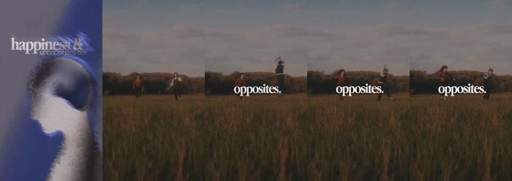

# v19_s03 · 02 B-roll + texto + overlay · 2.9–4.1s (calidad 4)

- **Guion:** opposites. If
- **Qué se ve:** B-roll cinematográfico: dos personas en un prado al atardecer, una lanza algo al aire. Palabra 'opposites.' centrada.
- **Diseño:** Serif Didone bold blanca centrada en el centro exacto; ~12 % del ancho de alto. Grading cálido desaturado (marrones #4A3623).
- **Efectos:** Desaturación parcial, grano fino de película, viñeta suave.
- **Animación:** Corte seco desde la ilustración; palabra aparece con pop corto (≈0.15 s) + blur-in.
- **Por qué aquí:** Palabra clave 'opposites' merece pantalla propia y una imagen humana: rompe la ilustración con realidad para descansar el ojo.
