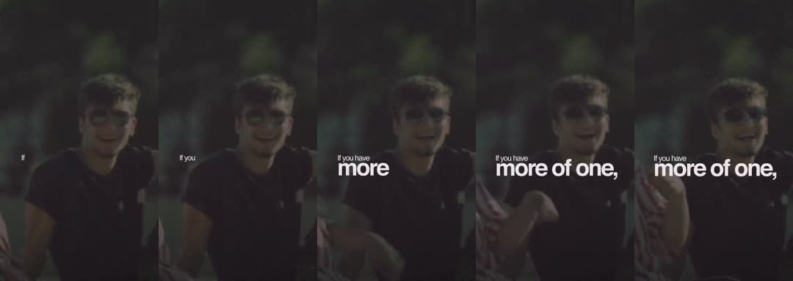

# v19_s04 · 02 B-roll + texto + overlay · 4.1–5.1s (calidad 3)

- **Guion:** you have more of one, you
- **Qué se ve:** Hombre joven sonriente con gafas de sol (b-roll emocional alegre). Texto 'If you have' pequeño + 'more' grande a la izquierda-centro.
- **Diseño:** Aquí la palabra destacada va en sans geométrica bold (tipo Inter/Helvetica Bold) blanca, 'If you have' sans pequeña encima. Posición: centro-izquierda, tercio medio-bajo.
- **Efectos:** Grading oscuro, desaturado; viñeta.
- **Animación:** Corte seco; texto pop por palabra (≈0.1–0.15 s).
- **Por qué aquí:** 'more' de felicidad = cara sonriente; ilustración literal del extremo positivo del dial.
