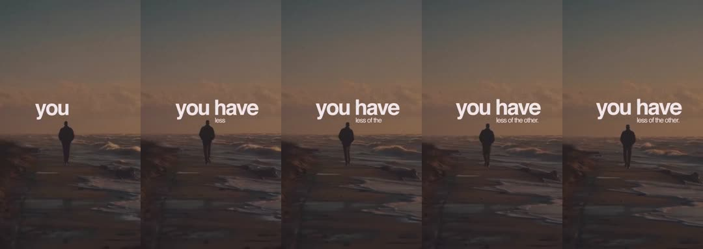

# v19_s05 · 02 B-roll + texto + overlay · 5.1–6.3s (calidad 3)

- **Guion:** have less of the other.
- **Qué se ve:** Hombre caminando solo por la orilla en penumbra (b-roll melancólico). 'you have' grande + 'less of the other' pequeño.
- **Diseño:** Sans bold blanca 'you have' centrada en tercio superior-medio, secundaria sans pequeña. Paleta marrón-gris #302927.
- **Efectos:** Desaturación, grano, contraluz.
- **Animación:** Corte seco; escritura palabra a palabra.
- **Por qué aquí:** Contrapunto emocional al plano anterior (alegre → solo): el montaje enseña la idea de 'opuestos' antes de que se discuta.
