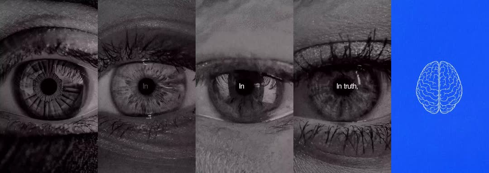

# v19_s08 · 02 B-roll + texto + overlay · 9.1–9.5s (calidad 4)

- **Guion:** In truth,
- **Qué se ve:** Macro de un ojo en B/N; 'In' y luego 'In truth,' pequeño blanco centrado sobre la pupila.
- **Diseño:** Sans regular blanca pequeña, centrada exactamente sobre la pupila. B/N puro.
- **Efectos:** Desaturación total, grano, alto contraste.
- **Animación:** Dos planos muy cortos (≈0.2 s cada uno) con micro-zoom out del ojo; texto pop.
- **Por qué aquí:** 'In truth' = 'mirar de verdad': metáfora visual de ver claro, puente rapidísimo hacia la explicación científica.
