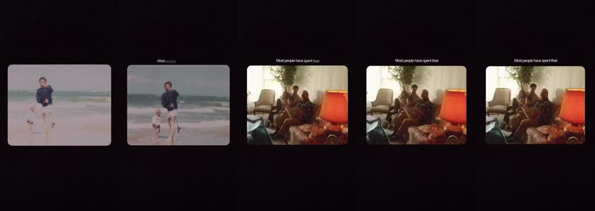

# v19_s16 · 02 B-roll + texto + overlay · 26.2–27.1s (calidad 4)

- **Guion:** Most people have spent their
- **Qué se ve:** Fondo negro; vídeo enmarcado en tarjeta con esquinas redondeadas (padre jugando con niño en la playa, look vintage) centrado; texto pequeño 'Most people have spent' encima.
- **Diseño:** Tarjeta ~85 % ancho, radio ~6 %, centrada; texto sans blanco diminuto en tercio superior.
- **Efectos:** Look de película casera: desaturado, lavado, grano.
- **Animación:** Tarjeta entra con scale-up suave (≈0.3 s); texto write-on.
- **Por qué aquí:** Cambio a 'la vida de la gente': el marco de tarjeta = recuerdo/memoria, humaniza tras el gráfico.
