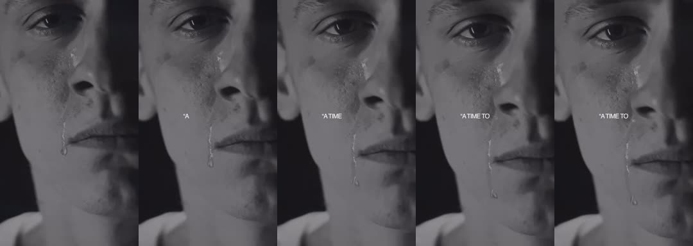

# v19_s26 · 02 B-roll + texto + overlay · 47.8–48.8s (calidad 4)

- **Guion:** a time to weep
- **Qué se ve:** Primer plano B/N de un rostro con una lágrima; texto '"A TIME TO' mayúsculas pequeñas centrado.
- **Diseño:** Sans mayúsculas blanca pequeña (~2.5 % altura), con comillas; centro.
- **Efectos:** B/N, grano, contraste alto.
- **Animación:** Write-on de la cita palabra a palabra.
- **Por qué aquí:** La cita se ilustra con la emoción literal (llorar).
