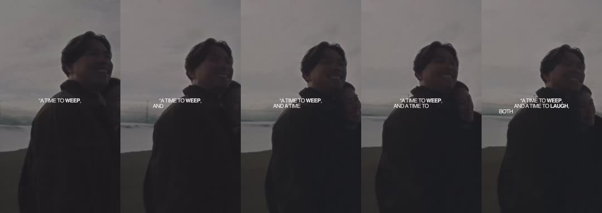

# v19_s27 · 02 B-roll + texto + overlay · 48.8–50.3s (calidad 4)

- **Guion:** and a time to laugh, both belonging
- **Qué se ve:** Hombre en la costa al atardecer, oscuro; '"A TIME TO WEEP, AND A TIME TO LAUGH,' con WEEP y LAUGH en bold.
- **Diseño:** Sans mayúsculas blanca, palabras clave en peso bold; dos líneas centradas.
- **Efectos:** Desaturado frío, grano.
- **Animación:** La cita se acumula línea a línea (write-on), sin borrar las anteriores.
- **Por qué aquí:** Cita acumulativa: el texto crece con la voz para que el espectador lea la frase completa.
