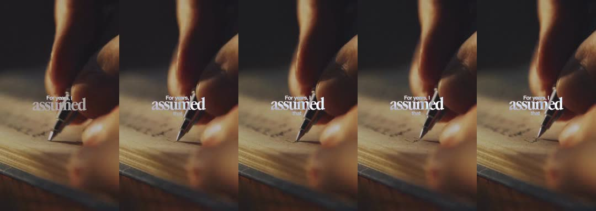

# v19_s31 · 02 B-roll + texto + overlay · 55.3–56.3s (calidad 3)

- **Guion:** years, I assumed that meant
- **Qué se ve:** Mano escribiendo con pluma estilográfica sobre un libro, luz cálida; 'For years, I' + 'assumed' grande + 'that'.
- **Diseño:** Serif Didone blanca grande centrada; tonos sepia/ámbar.
- **Efectos:** Grading cálido, profundidad de campo baja.
- **Animación:** Texto write-on con 'assumed' pop.
- **Por qué aquí:** 'Assumed' → escribir/creer: imagen de introspección y diario personal.
