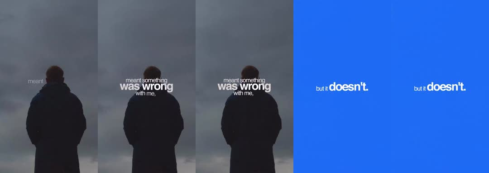

# v19_s32 · 02 B-roll + texto + overlay · 56.3–58.7s (calidad 3)

- **Guion:** something was wrong with me, but it doesn't.
- **Qué se ve:** Hombre de abrigo de espaldas bajo cielo gris; 'meant something' + 'was wrong' grande + 'with me,'. Luego un beat de pantalla azul vacía.
- **Diseño:** Sans bold blanca 'was wrong', resto sans pequeña; centro.
- **Efectos:** Desaturado frío; plano azul limpio #1369F7 después.
- **Animación:** Corte; el azul vacío funciona como respiro (≈0.5 s).
- **Por qué aquí:** Vulnerabilidad del narrador; el azul vacío marca el 'but it doesn't' (silencio = giro).
