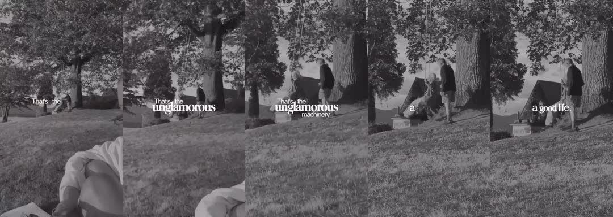

# v19_s40 · 02 B-roll + texto + overlay · 76.4–79.1s (calidad 4)

- **Guion:** machinery of a good life.
- **Qué se ve:** Señor mayor en columpio bajo un árbol, B/N; 'That's the' + 'unglamorous' + 'machinery' y luego 'a good'.
- **Diseño:** Serif Didone blanca 'unglamorous'; sans pequeña resto; centro.
- **Efectos:** B/N, grano, look documental.
- **Animación:** Write-on por palabra; dos planos del mismo sujeto.
- **Por qué aquí:** 'Unglamorous' = vida sencilla y ordinaria de un mayor: lo opuesto al glamour.
