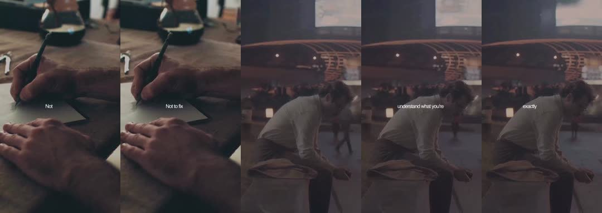

# v19_s48 · 02 B-roll + texto + overlay · 95.0–98.0s (calidad 3)

- **Guion:** Not to fix them, to understand what you're exactly
- **Qué se ve:** Manos escribiendo en un cuaderno ('Not'); luego hombre sentado de noche en la ciudad, pensativo ('understand').
- **Diseño:** Sans blanca pequeña centrada.
- **Efectos:** Grading cálido y nocturno, profundidad de campo baja.
- **Animación:** Cortes secos.
- **Por qué aquí:** 'Understand' = reflexión: imágenes contemplativas.
