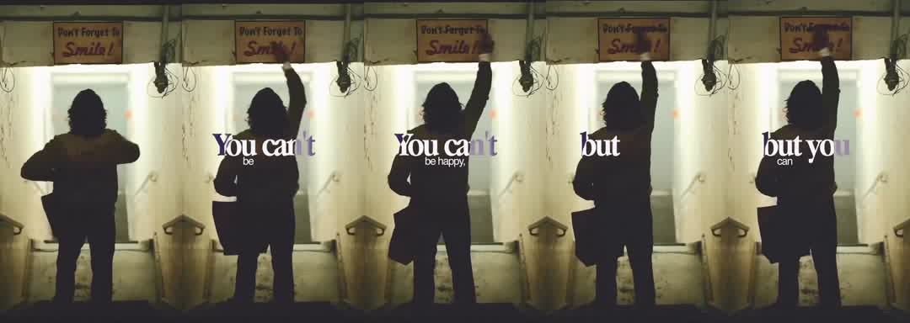

# v19_s50 · 02 B-roll + texto + overlay · 100.8–103.3s (calidad 4)

- **Guion:** You can't be happy, but you can be happier,
- **Qué se ve:** Silueta en un umbral luminoso con cartel 'Don't Forget To Smile!' (cine); 'You can't' serif grande con letras teñidas violeta + 'be happy,'.
- **Diseño:** Serif Didone bold blanca con parte de las letras en morado; centro.
- **Efectos:** Contraluz fuerte, grano, tonos verdosos.
- **Animación:** Texto pop; segunda toma 'but' grande.
- **Por qué aquí:** Remate ingenioso: cartel irónico 'no olvides sonreír' = felicidad forzada.
