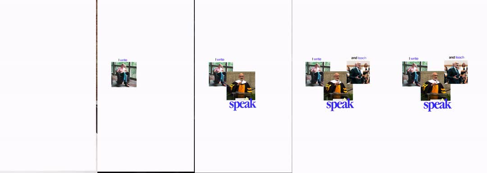

# v01_s03 · 03 Imágenes - personajes + texto · 2.3–4.1s (calidad 5)

- **Guion:** I write, speak, and teach about
- **Qué se ve:** Papel blanco: collage de 3 fotos pequeñas solapadas (él escribiendo en sofá, con toga académica, dando clase), cada una con su etiqueta 'I write' / 'speak' / 'and teach'.
- **Diseño:** Fotos rectangulares con borde blanco fino y sombra suave, ~25 % del ancho cada una, agrupadas en el centro. Etiquetas: 'I write' y 'and teach' sans pequeña con el verbo en azul; 'speak' serif itálica bold grande azul-violeta ~#4A3FE0 bajo el grupo. Fondo blanco #FAF8FB.
- **Efectos:** Sombras paralelas suaves (drop shadow) para dar volumen de papel impreso; sin textura visible.
- **Animación:** Cada foto entra al decir su verbo: pop+escala desde 90 % con ligera rotación y fade (≈0.25 s), solapándose sobre la anterior. Ritmo sincronizado palabra a palabra.
- **Por qué aquí:** Enumera identidades de una en una: cada verbo recibe su propia prueba visual (describir → mostrar).
